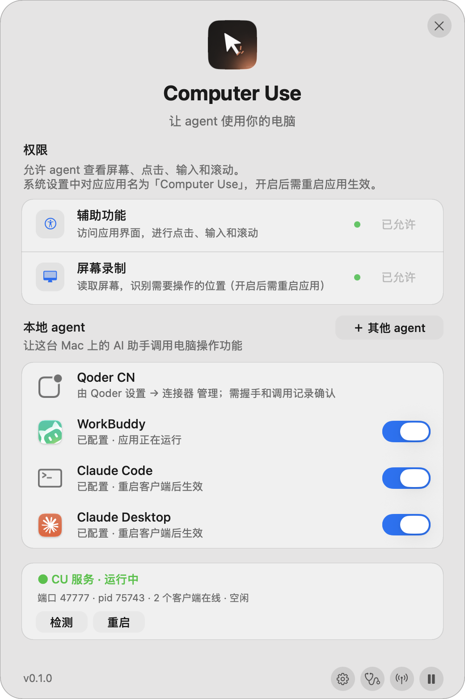

# DSH Super Computer Use

一个仓库、两层代码，给 DeepSeek Harness 提供完整的 macOS 桌面操控能力。

```
DSH  ──加载──▶  本仓库根目录（Cordis 插件，JS）
                      │  HTTP 127.0.0.1:47777
                      ▼
                 engine/（原生 Swift 引擎）──▶ macOS AX / ScreenCaptureKit / CGEvent
```

## 目录

| 路径 | 作用 |
|---|---|
| `lib/` | Cordis 插件：13 个 `cu_*` 工具、会话管理、附件预览 |
| `locale/` `skill/` | 插件文案与技能说明 |
| `test/` | 插件测试（Node） |
| `engine/Sources/` | 原生引擎源码（Swift） |
| `engine/build.sh` | 编译 `engine/bin/cu` |
| `engine/install-app.sh` | 打包并安装 `Computer Use.app`，注册 launchd 服务 |
| `install.sh` | 一条命令装完整个产品（引擎 + 提示接入 DSH 插件） |
| `assets/icon.png` | 插件与 App 共用的产品图标 |
| `engine/tests/` | 原生回归测试（光环/抓屏/窗口查询/控制台界面） |
| `docs/` | 设计与验证记录；`docs/legacy/` 为合并前两个仓库的历史文档；`docs/demo/` 为演示素材 |
| `docs/ui/` | 控制台界面的对照参考（`reference/`）与改造后截图（`console-after/`） |

## 安装

一个产品、一个命令：

```bash
./install.sh          # 引擎（app + launchd 服务）→ 再按提示接入 DSH 插件
```

分步说明如下。

### 1. 引擎（必须先装）

```bash
cd engine
./build.sh            # 产出 engine/bin/cu，用稳定签名身份签名
./install-app.sh      # 安装 /Applications/Computer Use.app + launchd 服务
```

首次安装后需在「系统设置 → 隐私与安全性」给 **Super Computer Use**
（磁盘路径 `/Applications/Computer Use.app`）授予
**辅助功能** 与 **屏幕录制** 权限。

签名身份**不随仓库提交**。想做到「重编译不丢授权」，在本机建一个文件：

```bash
security find-identity -v -p codesigning | awk -F'"' '/Apple Development/{print $2; exit}' \
  > engine/signing-identity
```

`engine/signing-identity` 已在 `.gitignore` 中。没有该文件时会退回 ad-hoc 签名
（可以运行，但重编译后 macOS 可能要求重新授权）。也可用 `CU_SIGN_IDENTITY` 覆盖。

校验：

```bash
~/Library/Application\ Support/cu/bin/cu perms
# {"accessibility":true,"screenRecording":true,"ok":true,...}
```

### 2. 插件

```bash
pnpm add link:/path/to/dsh-super-computer-use
```

在目标 DSH profile 中安装依赖，并确保 `package.json` 的 `dsh.profile.bundles` 包含 `dsh-super-computer-use`，然后重启 DSH 并验证插件已加载。技能名是 `/super-computer-use`（`/` 菜单里敲 `/super` 就能排到第一条）；工具加载成功时会注册 13 个 `cu_*` 工具。

## 能力

**插件工具（13）**
`cu_status` `cu_windows` `cu_launch` `cu_snapshot` `cu_expect` `cu_click` `cu_type`
`cu_key` `cu_scroll` `cu_screenshot` `cu_session` `cu_find` `cu_batch`

**视觉反馈**
- 边缘呼吸光：只在 agent 真正操作时出现的屏幕四边窄光带（蓝→青→紫，约 72pt），停手约 2 秒后自动淡出
- 渐变光环：跟随目标窗口，独立停止面板
- 毛玻璃 HUD：实时动作文本 + 计时器 + 脉冲状态灯
- 光标层：虚拟箭头滑向目标、动作标签、点击涟漪（不移动真实鼠标）

**菜单栏控制台**（菜单栏 `● CU` → 控制台…）

无边框毛玻璃圆角面板，一页看完：应用图标与标题、权限卡片（状态点 / 一键「去授权」+ 可拖拽的悬浮授权引导）、
本地 agent 连接开关（直接写入 / 移除 MCP 配置并回读状态）、服务状态卡（端口、在线客户端、正在做什么、检测 / 重启）。
底部固定版本、暂停与三个图标入口（连接与使用 / 诊断 / 设置）；「＋ 其他 agent」页给出可直接复制的 MCP 配置，
复制后按钮变「已复制」。视觉与交互参考 Claude CU Bridge，对照见 `docs/ui/reference/claude-cu-ui-notes.md`，
改造后截图在 `docs/ui/console-after/`。



界面本身可以被机器验证，不靠肉眼回归：

```bash
cu menubar --selftest-ui                       # 控制台结构的 JSON 断言
cu menubar --snapshot-console /tmp/c.png --snapshot-page overview   # 任一页渲染成 PNG
cu menubar --snapshot-guide /tmp/guide.png     # 授权引导浮窗
```

**引擎命令**（除插件外也可直接用）

```bash
cu windows | snapshot --pid <pid> [--window <id>] [--max-nodes 1500] [--no-actions]
cu click --ref <ref> --pid <pid> [--background]
cu shot --window <id> --format jpeg --max-dim 1280
cu halo --window <id> --label "..." | cu capsule --label "..." | cu cursor-overlay | cu capture-daemon
cu agents | agents-connect [--id …] | agents-disconnect [--id …]
cu menubar [--open-settings] | --selftest-ui | --snapshot-console <png> | --snapshot-guide <png>
```

## 实测性能

`npm run bench` 是一套固定任务集的基准（demo 窗口，无需第三方 app），数字直接取自工具返回的
`timings`，可重复跑、可比较模型和引擎版本。2026-11-03 的基线（每项 12 次）：

| 任务 | 成功率 | P50 | P95 |
|---|---|---|---|
| AX 快照 | 12/12 | 97 ms | 183 ms |
| ref 点击 + 观察 | 12/12 | 287 ms | 335 ms |
| 输入 + 显式后置条件 | 12/12 | 487 ms | 573 ms |
| 批处理 click→wait→key | 12/12 | 524 ms | 690 ms |
| 窗口截图（冷 daemon） | 12/12 | 346 ms | 398 ms |
| 结束会话 | 12/12 | 0 ms | 1 ms |

首个视觉反馈为 0 ms：光标提示在调用引擎之前就已发给 overlay。
完整的「优化前 → 优化后」与复跑方法见 `docs/bench/README.md`，机器可读结果在
`docs/bench/baseline.json`。

## 设计要点

- **后台优先**：默认通过 AX / `CGEventPostToPid` 操作，不抢焦点、不移动真实鼠标
- **常驻抓屏**：`capture-daemon` 复用 `SCShareableContent` 缓存，按目标尺寸直接出图
- **失败不重放**：动作已派发但观察失败时，保留动作结果并标记 `actionReplaySafe: false`
- **截断可见**：快照超过节点预算时返回 `truncated: true` + `limit`，可用 `maxNodes` 提高
- **观察有节律**：动作后的观察在树没变化时按预算重读（默认 300 ms），并报告 `changed` / `waitedMs` / `reads`；"树动了" 只是重新观察的信号，不等于业务成功
- **后置条件优先**：动作可带 `expect`（或单独调 `cu_expect`），由引擎轮询到条件成立；`cu_batch` 里的 `expect` 步骤就是检查点
- **目标有身份**：每次观察带 `snapshotId`，ref 点击可带上它，快照过期时返回 `stale_snapshot` 而不是命中同名控件
- **坐标有出处**：`cu screens` 给真实显示器可用区域，截图带 `capturedAt` / `displayId`，窗口移动后按实时 bounds 计算 origin
- **用户可中断**：胶囊与光环上的停止键会写入暂停标记，所有变更类动作随即被拦截
- **会话侧栏布局**：进入操作会话时 DSH 窗口缩到右侧三分之一、目标窗口占左侧，结束时自动还原；首次点击也会缩窗但不动目标窗口（避免点击坐标失效）
- **录屏有提醒**：会话期间菜单栏显示 `● CU · REC`，同时 macOS 升起系统录屏隐私指示；结束时一起消失
- **控制台不粘焦点**：只有你点开控制台时才激活窗口；关掉后立即把焦点还给之前的应用
- **界面可回归**：`--selftest-ui` / `--snapshot-console` / `--snapshot-guide` 让每次改版都有断言与截图证据
- **光效不常驻**：边缘呼吸光只在动作时亮起；overlay 进程 2 小时无活动自动退出，不会遗留常驻光斑
- **授权可自愈**：缺权限时给系统设置深链 + 可拖拽应用卡片的引导浮窗；失效授权只在日志有证据且确实缺权限时才重置

## 常见疑问

**重启后 `cu_*` 工具全没了？**

先看 plugin 链接指向哪里：

```bash
readlink ~/.dsh/profiles/<profile>/node_modules/dsh-super-computer-use
```

DSH 从 profile 的 `package.json` 解析 `dsh-super-computer-use`（`link:<仓库路径>`），重启时按这个路径加载。
如果它指向一个空目录（例如另一个同名工作区），插件整包解析失败，13 个工具和技能会一起消失，日志里不会留明显错误。
把链接改回真实仓库后重装再重启：

```bash
cd ~/.dsh/profiles/<profile>
pnpm add link:/path/to/super-computer-use    # 或手改 package.json 里的 link: 再 pnpm install
```

验证：`readlink` 指向仓库，且 `node -e 'import("dsh-super-computer-use")'`（在 profile 目录下）能打印出 `apply`。
重启后 `cu_status` 应返回 `vision` 与 `lastImage` 字段——没有这两个字段说明跑的还是旧版插件。

**重启后工具还是没起来？先看 `~/.cu/plugin-boot.log`**

宿主在注册每个工具时校验 `parameters` 的 schema DSL，不合法就**抛错**。而注册发生在插件的 `apply()` 里，
所以一个参数写错会让整个插件的 13 个工具一起消失，界面上没有任何错误提示。日志里会留下：

```
module evaluated (pid 12345)
apply() entered
tool cu_click rejected: parameters.expect.additionalProperties must be explicitly true or false
```

DSL 里最容易踩的三条：`type: "object"` 必须显式写 `additionalProperties: true|false`；
每个参数的 `required` 只能写 `true`（不能写 `false` 或数组）；对象的嵌套属性同样要满足这两条。
`npm test` 里的 `test/tool_schema.mjs` 会把全部 13 个工具按同一套规则验一遍，改 schema 后先跑它。


**Super Computer Use 和 DSH Super Computer Use 是什么关系？**

产品整体品牌为 **Super Computer Use**：它是本机的多 AI 应用引擎与菜单栏控制台；而 **DSH Super Computer Use** 是 DeepSeek Harness 专用的插件适配层，通过本机服务调用引擎。WorkBuddy、Claude 等支持 MCP 的 AI 应用也可以直接接入本体。配置存在并不代表客户端当前会话已连接，需通过工具调用验证。

本机应用继续使用 `/Applications/Computer Use.app`、bundle id `local.cu.app`、launchd 标签 `local.cu.*` 和命令 `cu`，以保持现有配置及授权身份的连续性。重装后的权限状态仍应实际检查。

插件和应用的版本从根目录 `package.json` 生成；安装或升级任一组件后，需验证另一组件版本及运行状态。

**启动台/应用程序里的 “Computer Use” 是什么？可以删吗？**

它就是引擎本体：launchd 后台服务（`local.cu.service`）、菜单栏助手（`local.cu.menubar`）、
**辅助功能/屏幕录制权限宿主**及控制台。DSH 插件通过 `127.0.0.1:47777` 和引擎协作；其他 AI 客户端可通过 MCP 使用。删除 app 会影响控制台及引用该路径的组件；后台服务还可能使用独立的硬链接，因此不要把删除应用当作完整卸载。

它故意不占 Dock（`LSUIElement`），但启动台会列出 `/Applications` 下的应用，所以能看到它：

- 从启动台/应用程序打开它 = 打开控制台，同时确保菜单栏的 `● CU` 在跑。
- 菜单栏里的「退出菜单栏」只退出菜单栏助手，后台服务继续工作；重新打开 app 即可恢复。
- 早期版本 `build/` 目录下的复制品被删除后，可能在启动台留下点不开的“幽灵”图标；
  系统注册信息可以用 `lsregister -gc` 清理（或重装一次）。

## 历史

本仓库由两个旧仓库合并而来：

- `computer-use` —— 原生 Swift 引擎（现位于 `engine/`）
- `dsh-computer-use` —— DSH Cordis 插件（现位于仓库根）

两者的 git 历史保留在原仓库中，本仓库以合并后的完整形态作为唯一维护入口。

## License

MIT
