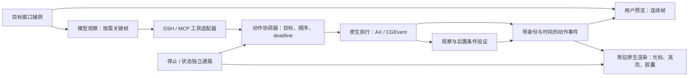

# Super Computer Use：Codex 式操作动画与整体体验优化技术方案

日期：2026-11-04。交付对象：接手开发的 AI / 工程师。状态：**设计与开发交接，尚未实施**。

代码基线：`8e1f6ce`。本方案结合用户提供的录屏、现有 Swift/Node 实现和第二轮复查。开始本次分析时，工作区已有未跟踪的 `docs/reviews/`，产品代码没有新差异。

## 1. 目标与技术决策

目标是让用户持续看懂 AI 正在操作哪个应用、哪个控件、是否已经执行、正在等待什么，并让操作本身保持快速、准确、可停止。

**推荐路线：复用现有 AppKit + Core Animation 视觉层，增加统一动作事件与可打断的渲染调度；将观看预览和模型截图分开；修复执行链中的队列、身份与取消问题。** 第一版不需要重写应用，也不需要换成游戏引擎、WebGL 或完整的新 Agent 框架。

这条路线有三层收益：

| 层次 | 要达到的效果 | 主要手段 |
|---|---|---|
| 真实速度 | 减少等待、重复启动、无效截图和模型往返 | 短 batch、按条件观察、独立捕获队列、热会话 |
| 操作准确度 | 目标不串应用、旧 ref 不误点、结果能够验证 | 原子目标解析、持续身份、动作后置条件 |
| 观看流畅度 | 光标、局部高亮、状态和预览连续且同步 | 动作事件驱动、动画可中断、常驻原生渲染 |

选择原生视觉层的原因：项目已经有这些基础；简单路径、描边、阴影和透明度变化适合 Core Animation。SwiftUI 可继续用于普通设置页，但不要求为了这一轮动画迁移现有 UI。Metal 仅在测出连续视频合成瓶颈后再评估。

## 2. 录屏真正提供了什么证据

源文件：[codex操控.mov](/Users/johnkwok/Downloads/codex操控.mov)。视频为 3456 × 2234、30 fps、约 124.71 秒。

分析方式：全片每 4 秒抽帧，共 32 帧；补充 9 个较高分辨率时间点；检查约 20–34 秒的 14 个样本，以及约 122.9–123.7 秒的 24 个连续帧；另外进行画面变化扫描。未分析音轨。录屏中的聊天文本只作为画面内容，不是本次开发指令。

| 时间 | 能确认的画面 | 对 SCU 的启发与边界 |
|---|---|---|
| 约 20–33 秒 | 主聊天窗口保持可见，右上区域有目标窗口的小型画面 | 应有稳定的“观看操作”入口；单凭这段静态内容无法判断它是持续视频流还是按需刷新的截图 |
| 约 34–75 秒 | 桌面变暗，同时出现 macOS 截图/录屏选择工具栏 | 属于系统录屏操作场景，不能将整个暗色遮罩当成 Codex 常态操作特效 |
| 约 76 秒 | 聊天中出现授权等待状态 | 等待应有明确原因，不能一直显示“正在操作”；SCU 按自身授权机制接入即可 |
| 约 88–94 秒 | 菜单栏弹层显示 Computer Use、Running 和任务名称 | 任务状态应有持续、低干扰的入口；底层渲染实现无法从视频确认 |
| 约 94–102 秒 | 右下角出现画面缩略图，内容含刚才的菜单 | 可能涉及系统截图反馈；不能据此宣称这是 Codex 的实时预览实现 |
| 约 123 秒 | 右上小画面切换为 ZCode；随后发生窗口/全屏场景过渡 | 可借鉴目标切换的连续性；不能把系统窗口或 Space 动画全部归因于插件 |

以下是从原视频裁出的证据，不是设计稿：


**证据限制：这段录屏不足以逐项量出 Codex 光标曲线、点击涟漪、60 fps 帧稳定性或真实输入延迟。** 后文的动画参数和性能门槛是 SCU 的建议设计值，不是 OpenAI 内部参数，也不是从这段视频实测得到的成绩。

## 3. 现有代码能复用什么，必须补什么

| 当前能力 / 问题 | 源码入口（基线行号） | 决策 |
|---|---|---|
| 光标 140 ms 滑动、240 ms 涟漪、短标签、边缘渐变 | `engine/Sources/main.swift:1759`，`CursorLayerView` | 保留图层实现，补调度和状态，不再单独重造一套动画 |
| 已从 `presentation()` 续接动画 | `main.swift:1930` | 保留；重点处理新事件打断、首次出现和过期反馈 |
| ref、坐标、batch 点击已有反馈 | `lib/core.mjs:613`、`:640`，`lib/index.mjs:1187` | 将各工具的零散反馈收敛为同一动作事件 |
| overlay 每条输入都提交到主队列，缺少序号、会话隔离和确认 | `main.swift:2443` | 增加协议版本、事件身份、合并策略和渲染确认 |
| 各屏取并集创建一张大 overlay | `main.swift:2443` | 改为每块显示器一个透明 panel，避免屏幕空隙和缩放错误 |
| 胶囊、halo、cursor 分别启动；同目标重启仍重建指示器 | `lib/core.mjs:1426` | 同会话保持渲染进程与图层，更新内容即可 |
| 预览有预算，但超时后还能启动 fallback；附件保存不在预算内 | `lib/index.mjs:203`、`:225` | 先修取消与 deadline，再做连续画面 |
| 服务读请求先进入动作串行队列 | `main.swift:3749`、`:3881` | 在动作排队之前分类；状态和取消使用独立通路 |
| pid/window 独立继承，snapshotId 只表示客户端缓存版本 | `lib/index.mjs:933`、`lib/core.mjs:1135` | 原子目标 + 持续身份校验；不能把序号等同于真实控件身份 |
| rim 关闭后会被动作重新点亮；默认 preview 重复预热；schema 必填冲突 | 第二轮复查 F6/F7/F8 | F7/F8 先修，F6 随视觉层修复交付 |

详细复现与证据见 [第二轮复查](/Users/johnkwok/Downloads/work/super-computer-use/docs/reviews/second-review.md)。此前的 73/73 测试通过和 demo 延迟数据属于上一轮测试，本次只复核源码与录屏，没有重新运行整套性能测试。

## 4. 最终观看体验与动画规范

### 4.1 用户看到的完整过程

1. 会话开始：显示目标应用和任务状态，目标窗口出现轻描边；不自动调整用户窗口布局。
2. 找到控件：控件附近出现代理光标和局部高亮，短标签说明“点击 搜索”或“输入 搜索框”。
3. 派发动作：实际输入 API 接受动作后显示一次反馈；业务成功仍由后置条件判定。
4. 等待应用：胶囊显示“等待搜索结果”，不让光标无意义移动，也不持续强闪。
5. 验证结果：满足条件才显示完成；没有声明条件则显示“已执行，未验证”。
6. 用户停止：先显示“正在停止”，快速阻止后续输入；确认在途处理结束后再显示“已停止”。

观看入口是一个可收起的小预览窗。它让聊天保持可见；用户可主动展开预览或切到目标应用。**展开预览只改变 SCU 自己的观看窗口，不应隐式改变目标应用尺寸或进入系统全屏。**

### 4.2 动画参数表

下表是首版调参起点，均为逻辑点 pt；应在 1×/2× 屏幕上保持视觉尺寸一致。

| 元素 | 首版设计 | 事件依据与约束 |
|---|---|---|
| 代理光标 | 保留约 22 pt 箭头与低强度辉光；正常移动 140 ms，ease-out | 从当前 presentation 状态接续；首次出现直接定位并淡入，不能从屏幕原点飞来 |
| 点击反馈 | 保留直径 8→52 pt、240 ms 淡出；最多同时显示 2 个 | 以引擎返回的实际作用点为准；拒绝动作不显示成功涟漪 |
| 控件高亮 | 2 pt 描边，填充 alpha ≤ 0.06；出现 80 ms，结束淡出 160 ms | 使用已确认且仍有效的控件矩形；拿不到矩形就只显示光标/状态 |
| 目标窗口高亮 | 1.5 pt 描边，低强度阴影；切换淡入淡出 120 ms | 跟随真实窗口几何；失去目标立即清除旧框 |
| 动作标签 | 11–12 pt，最多 28 个用户可见字符；只含动作与控件名 | 按字素截断，不展示完整输入内容；尽量放在目标框外，并夹紧到单屏可见区域 |
| 状态胶囊 | 约 280 × 42 pt，内容变化用 100 ms 交叉淡化 | 不为每个状态销毁窗口；停止按钮始终可用，装饰部分不抢键盘焦点 |
| 预览卡片 | 默认宽 320 pt，画面等比适配；圆角 12 pt | 首帧淡入 120 ms；不同目标在新目标首帧有效后交叉淡化 120 ms |
| 展开/收起预览 | SCU 观看窗自身 180 ms 的 frame/opacity 动画 | 可中断；不伪装为目标应用已激活，不驱动目标窗口跟着移动 |
| 边缘光 | 日常模式关闭；演示模式可选，宽 24–48 pt，低透明度 | 只有动作期间点亮；空闲 2 秒后 300 ms 淡出；中心保持透明 |

颜色首版延续现有蓝青色，减少品牌和材质重做。演示模式可增加蓝紫渐变。**参数应集中到一个 `VisualTheme`，但首版只给用户“日常 / 演示”和系统减少动态效果的必要选项，不做完整主题编辑器。**

### 4.3 正确处理快速动作

最容易破坏观感的情况是：A 的点击已执行，视觉光标仍在滑向 A；B 又执行，A 的动画随后才播放完。

采用以下规则：

- `targetReady` 可以提前开始定位动画，但执行器不等待动画结束。
- 收到真实 `dispatched`，若视觉光标尚未到实际作用点，立即结束该段滑动并对齐，再显示涟漪。允许缩短动画，不能为了“完整播放”拖慢输入。
- 快速 batch 中，光标移动和标签只保留最新项。点击事件保留在事件记录中；视觉上最多 2 个涟漪，超过可显示“已执行 N 步”，不在结束后补播一串旧点击。
- 晚于更新目标的旧几何、旧会话事件，不再作用于当前屏幕。
- `reduceMotion` 开启时取消位移滑动、扩散和呼吸；保留静态定位、短暂透明度反馈和状态文字。运行中切换也要立即移除已有循环动画。

Core Animation 的 presentation layer 可以读取动画当前呈现值，适合在中断时续接；现有代码已采用这个方向。[Apple CALayer 文档](https://developer.apple.com/documentation/quartzcore/calayer/presentation())

### 4.4 不同动作分别如何表达

| 动作 | 视觉表达 | 避免的错误 |
|---|---|---|
| click / doubleClick | 同一实际目标点的涟漪；双击是一组短反馈 | 不把 AX 接受动作等同于业务成功 |
| type / setValue / paste | 输入框轻描边，标签“输入 搜索框” | 不把粘贴伪装成逐字敲击；不在气泡中重复显示敏感输入 |
| scroll | 在实际滚动容器边缘显示短方向提示 | 不额外播放一套与真实页面不同步的假滚动 |
| drag | 从引擎实际派发的位置更新拖动指示 | 不用预设曲线表示尚未发生的拖动；结束/取消要处理本工具持有的按键与鼠标键 |
| key | 胶囊显示短键名；有可靠字段焦点时轻亮该字段 | 不凭旧光标位置虚构键盘作用目标 |
| wait / expect | 显示具体等待条件及耗时 | 不显示假进度百分比；不宣称知道模型内部思考进度 |
| failed / unknown | 局部反馈清除，胶囊给出简短原因 | 不自动重放可能已生效的动作 |

## 5. 架构：动作、画面、模型观察分开推进



执行器不等动画、不等可选预览。模型仍在需要做判断时接收图像和 AX 状态；本地渲染无需每帧调用大模型。

### 5.1 分阶段接入，避免一次重写

第一阶段在现有 `CuSessionManager` 中建立唯一的事件归一化入口 `publishActionEvent()`，将现有点击、batch、输入、滚动和会话反馈接入。此阶段能利用的时间只是适配器接收/执行返回时间，必须标注 `source: "adapter"`；不能把工具返回时间包装成实际输入时刻。

随后增加原生流式执行协议：引擎在找到目标、派发输入、完成验证时直接输出事件，适配器转发到同一个入口。服务端保留动作串行顺序和独立取消通路。既有 CLI 默认单 JSON 输出不变；通过显式能力协商启用事件流，避免破坏其他客户端。

持续 AX 身份和观察 worker 是下一阶段执行优化；动画首版不需要等待完整 worker 重构。缺少可靠身份时，动作要返回需要重新定位，而不是声称已经有身份保证。

### 5.2 事件协议 v1

以下是**新增设计接口**，不是当前已经存在的 API。字段在 Node 和 Swift 两端保持一致。

```ts
type Target = {
  pid: number;
  windowId: number | null;
  targetGeneration: number; // 绑定应用/窗口改变时递增
  geometryVersion: number;  // 窗口/屏幕几何改变时递增
};

type ActionEvent = {
  version: 1;
  sessionId: string;
  actionId: string;
  eventId: string;          // 原发布者生成；转发重试保持不变，用于去重
  seq: number;              // 由会话事件归一化入口递增
  stepIndex?: number;
  source: "adapter" | "native";
  phase: "accepted" | "targetReady" | "dispatched" | "waiting"
       | "verified" | "unverified" | "failed" | "cancelled" | "unknown";
  kind: "click" | "type" | "key" | "scroll" | "drag" | "observe" | "expect";
  target: Target | null;    // 受理或定位失败时允许为空；不可虚构目标
  clockDomain: string;
  emittedNs: string;        // 字符串，避免 JSON 大整数精度损失
  point?: { x: number; y: number }; // 全局左上原点，逻辑点
  rect?: { x: number; y: number; width: number; height: number };
  label?: string;           // 展示用短描述，不传原始输入正文
  reason?: string;
  verification?: { matched: boolean; evidenceRef: string };
};
```

协议约束：

1. `accepted` 表示任务被受理；`targetReady` 表示本次目标已解析；`dispatched` 表示输入 API 已接受派发。后两种事件必须有有效 target。`verified` 必须有后置条件证据，且 verification.matched=true；evidenceRef 指向该动作的验证记录。没有条件则终态为 `unverified`。
2. 派发前拒绝可为 `failed`。派发后连接断开、取消或超时且无法确认结果，使用 `unknown`，禁止自动重放。
3. 取消中是会话控制状态，不立即产生 `cancelled` 终态；只有确认该动作已停止继续执行、并完成必要收尾后才能发该终态。
4. `eventId` 用于跨转发去重，`seq` 用于最终渲染顺序；`sessionId`、`targetGeneration` 防止旧任务污染；它们都不证明控件身份。原生输入事件尚无归一化 seq，由 manager 先去重再编号；不能每次重传都生成新的事件身份。
5. 原生事件使用统一的原生单调时钟。适配器的 `performance.now()` 与原生时间不能直接相减；跨域记录各自耗时或用外层统一时钟测完整往返。
6. `(0, 0)` 是合法点。只有缺失、非有限数或不在已确认目标范围时才拒绝；不以坐标为零判断无效。
7. 标签长度、类型、目标归属在进入渲染层前验证；非法视觉消息不应打断真实动作。

会话配置单独发送 `session.configure`，包括 `sessionId`、`rimEnabled`、`reduceMotion`、`mode`。`rimEnabled=false` 必须成为渲染器持久状态；后续 cursor/click/label 不能重新点亮它。

### 5.3 原生事件怎样从当前执行链送出

建议在兼容原协议的基础上增加 `eventsVersion: 1` 能力：

- 支持时，`POST /v1/exec` 接收可选 `eventContext: {sessionId, actionId, targetGeneration}` 与 `eventsVersion: 1`。
- 服务启动命令子进程的事件模式，增量读取输出；每行是 `{"kind":"event","event":...}` 或最终 `{"kind":"result","result":...}`，响应使用 NDJSON 流。
- 原生代码在目标解析成功后发 `targetReady`，在实际 AX/CGEvent 派发后立即发 `dispatched`；不能等截图、expect、进程退出之后再发。
- Node 客户端增加 `exec(argv, signal, {eventContext, onEvent})` 的可选第三参数。旧双参数调用保持兼容，不能把多行输出继续交给单次 `JSON.parse()`。
- 仍在 JS 中完成的验证可发布 `source:"adapter"` 的验证事件，附上可追溯的验证结果；每个阶段只有一个发布者，避免 native 和 adapter 重复发布。
- 没有事件能力时走旧调用，仅展示“执行返回”的反馈并记录降级。原生阶段时间缺失必须保留为 null。

这一步只增加一种事件流传输，不同时引入 WebSocket、gRPC 和另一个消息总线。

### 5.4 渲染通路

保留现有 stdin JSONL 驱动的原生 helper，增加 `cmd:"event"` 消息。helper 常驻于当前会话，同目标继续操作时不重启。

每块显示器单独建立全局坐标→AppKit 局部逻辑点的变换：先根据主显示器坐标锚点转换 y 轴，再减去目标屏幕的 Cocoa origin。不能使用随焦点改变的 `NSScreen.main` 代替固定坐标锚点；只有进入截图像素空间时才应用 backing scale。屏幕布局变化使相关 geometryVersion 失效。

在主线程前设置有界调度器：同一显示器的光标位置、标签、窗口几何各保留最新项；视觉瞬态队列上限 64。超过上限先清理过期移动/标签，保留最新会话状态和停止状态。完整动作记录另存，不通过视觉队列充当审计日志。

原生事件在同一时钟域中超过 250 ms 的过时移动不再补播；适配器事件没有可比较时钟时，只按接收队列年龄和 seq 判断，不假算源端延迟。关闭会话立即清空瞬态和所有动画。

stdout 返回 `RenderAck {sessionId, seq, receivedAtNs, committedAtNs, clockDomain}`。它只证明消息已接收、图层事务已提交，**不能命名为“首帧已显示”**。真正的屏幕呈现延迟需要录屏/帧观测验证。

## 6. 连续预览：用户看流，模型看关键帧

### 6.1 首版实现

新增原生 `PreviewController`，与预览 panel 在同一个 GUI helper 进程内持有 `SCStream` 和视频 buffer，避免每帧转 base64 经 Node 再传回来。

建议初始配置：目标窗口捕获、最长边 1280 px、活跃时上限 15 fps、可见但空闲时上限 2 fps；预览隐藏时暂停流。无音频采集。`SCStreamConfiguration.queueDepth=3`；应用自己只持有最新 1 帧待显示，两者不能混为一个队列。

`minimumFrameInterval` 可以限制 ScreenCaptureKit 更新率；Apple 示例说明了内容过滤、buffer 回调和运行中更新配置的方式。它是更新率上限，不能保证静止窗口持续产生新帧。[Apple minimumFrameInterval](https://developer.apple.com/documentation/screencapturekit/scstreamconfiguration/minimumframeinterval)、[Apple 捕获示例](https://developer.apple.com/documentation/screencapturekit/capturing-screen-content-in-macos)

UI 光标和描边由 Core Animation 独立渲染，可按显示器刷新率呈现；视频内容 15 fps 与装饰层流畅度分开测量。首版用 `AVSampleBufferDisplayLayer` 呈现 sample buffer，它支持显示视频帧；不把逐帧 JPEG 编码作为默认显示路径。[Apple AVSampleBufferDisplayLayer](https://developer.apple.com/documentation/avfoundation/avsamplebufferdisplaylayer)

保持当前 `arm64-apple-macos14.0` 构建目标，不为本轮动画提高最低系统版本；新增 API 要检查 availability。视频层的时间基准与丢帧策略必须显式设置，不能把历史 sample buffer 按原时间戳积压播放。必要时在 `engine/build.sh` 中补充 AVFoundation 链接。

### 6.2 帧身份与画面准确性

每帧记录：`frameId / sessionId / targetGeneration / geometryVersion / capturedAtNs / clockDomain / contentRect / pixelSize / scale / status`。

- 优先捕获目标窗口；显示器捕获则排除 SCU 装饰和预览窗口，避免镜中镜。只排除实际 helper 窗口/进程，不能粗暴排除与目标同进程的所有窗口。
- 用户预览中的代理光标在显示端合成；模型截图默认不含装饰层。
- 窗口缩放、跨屏、裁切和预览 letterbox 都必须参与坐标换算。预览坐标：`offset + (globalPoint - contentOrigin) × fitScale`，不能只乘 Retina 比例。
- 只有帧与事件的目标、几何版本匹配时，才在该帧上画局部目标。新几何还没有对应帧时，显示“更新画面”，暂不绘制可能错位的光标。
- 模型动作后的关键帧还应满足对应动作的捕获时序要求；“缓存中最新”不等于“动作之后”。图像本身也不能替代业务后置条件。
- 最小化、锁屏、目标退出或长时间无有效帧时显示“画面暂不可用/最近画面”，不把旧图标为实时。

### 6.3 捕获故障与回退

本项目已有 ScreenCaptureKit 在某些服务启动上下文中无回调的历史。先在实际打包、签名、启动路径下验证首帧和持续帧；不能因为 API 存在就写成已解决。

流启动 1500 ms 仍无有效首帧即进入降级，取消本次 stream，释放资源。回退为按动作完成或用户刷新触发的静态预览，额外捕获最多每秒一次；不循环高速运行 `screencapture` 假装连续视频。

可选模型截图继续使用当前默认预算起点（例如 600 ms），但从排队、捕获、编码到附件保存全部使用同一 deadline。不可取消的宿主附件 API 可自行结束，其迟到结果不能覆盖新帧或会话状态，也不能触发后续 fallback。

## 7. 真实速度与准确度的配套修复

### 7.1 原子目标解析——对应 F1/F8

`resolveTarget(explicit, session)` 的规则固定为：

- 完全没有显式目标时，继承整个会话目标。
- 显式 pid 不同于会话 pid 时，不继承旧 windowId。
- 只给 windowId 时，由引擎确认 owner；同时给 pid/windowId 时，必须一致，否则 `target_mismatch`。
- 同应用多窗口时保持显式窗口；无法唯一选定窗口时返回可选择的目标，不猜另一个窗口。
- 引擎禁止用 window owner 静默覆盖传入 pid。schema 支持的缺省与运行时一致，并经过真实宿主参数验证。

目标显示名称、窗口框和动作派发都消费同一份解析结果。

### 7.2 读、执行、取消、捕获各用合适通路——对应 F2/F3/F7

在接入连接后，用有并发上限的 I/O 通路读取和验证请求，再分类。首版限制 8 个并行请求读取、保留读取超时和现有请求体上限；满载时返回明确忙碌状态。不要把无界线程池当作修复。

只让实际输入动作进入串行执行队列。状态查询和取消走独立控制队列；只读 expect 的等待不能持有共享状态锁。捕获使用独立、有界队列，过期预览在入队、出队、fallback、附件发布前均检查 deadline/generation。

默认 session 是否预览只计算一次 `shouldPreview`，预热使用其反值。省略、true、false 和无窗口四条路径分别验证，避免默认路径抓两张图。

### 7.3 真实目标身份——对应 F4

`snapshotRevision` 只表示一次观察；新增 `elementToken` 才表示目标身份。建议在常驻 `AXSessionWorker` 内保留 AX 对象，token 绑定 session epoch、pid、窗口、对象与相关容器身份。路径和文字只用于重新定位候选，不足以证明“还是原控件”。

动作前在 worker 中做最后一次身份、归属、enabled 和几何读取，尽量在同一串行执行上下文紧接着派发。仍需承认跨进程 UI 会变化，不能宣称检查与目标应用的输入处理是原子事务；不确定时返回 `stale_target` / `identity_unproven`。

AX 通知用于使缓存失效、唤醒等待；不支持通知时采用有预算的轮询，不能把“没收到通知”当作“页面没变化”。Apple 明确列出通知不支持等错误情况。[Apple AXObserverAddNotification](https://developer.apple.com/documentation/applicationservices/1462089-axobserveraddnotification)

复用 `StateInspection.swift`、`ControlLease.swift`、`ProcessSupervisor.swift` 前先核对其注释和边界。现有 retained AX 检查需要实际保留对象；进程本地 lease 不能自动保证跨重启隔离；supervisor 确认直接子进程退出不代表所有后代都退出。

worker 首版服务一个活动控制会话，先覆盖 snapshot/ref click/expect。退出、服务重启和重新绑定都生成新 epoch，旧 token 全部失效。不要为这轮优化构建通用多租户执行平台。

### 7.4 减少模型往返

保留 `cu_batch`，优先将已知、短且带检查点的步骤合为一次工具调用，例如“聚焦输入框 → 输入唯一搜索词 → 提交 → 等待结果”。一旦需要新的判断就返回观察，不继续盲点。

原生应用优先 AX 语义定位；浏览器已有可用 DOM 路径时优先复用；画布和不透明控件使用截图定位。首版不新写浏览器扩展，也不为模仿 REPL 额外建立任意代码执行工具。

已存在会话复用 pid/window/ref 上下文；按需返回 AX 差异和关键截图。热路径是否值得迁移到常驻执行 worker，衡量完整任务的启动次数、身份复用与 P95，不只比较一次 spawn。

### 7.5 停止与接管

停止需要三个不同时间点：UI 响应、输入闸门关闭、在途动作/资源收尾完成。单独记录，不能以 `stopVisualSession()` 返回时间替代全部停止耗时。

控制通路先锁定暂停状态并拒绝新输入，再通知执行器停止后续步骤，取消观察与捕获；只释放本工具持有的键/鼠标键，最后回收 helper 和恢复本次会话确实调整过的布局。确认不了结果则报告 `unknown`，保留暂停，不自动恢复控制。

恢复必须重新观察并校验目标。同目标自动启动或会话续期不能清除用户已触发的暂停。若接入人工输入检测，应区分工具注入与真实用户输入，避免把自己触发的事件当成人工接管。

## 8. 文件职责和改动范围

路径相对仓库根 `/Users/johnkwok/Downloads/work/super-computer-use`。下面标为“新增”的文件均为计划，尚不存在。

| 文件 | 改动职责 |
|---|---|
| `lib/index.mjs` | 工具 schema、原子目标入口、动作阶段发布、预览整体预算 |
| `lib/core.mjs` | 会话生命周期、事件归一化、原生事件流消费、helper 管理与 batch 接线 |
| **新增** `lib/action-events.mjs` | v1 事件验证/归一化与去重；不执行系统输入 |
| **新增** `lib/preview-deadline.mjs` | 共享 deadline、generation、取消检查；供完整预览链使用 |
| `engine/Sources/main.swift` | 服务请求分类、事件模式 CLI 路由、实际派发点事件；保留旧调用兼容 |
| **新增** `engine/Sources/VisualFeedback.swift` | 从 main.swift 定点迁出 `CursorLayerView` 与 cursor overlay；增加 per-display 调度和 ack |
| **新增** `engine/Sources/PreviewController.swift` | SCStream、最新帧、原生预览 panel、降级与生命周期 |
| **新增** `engine/Sources/AXSessionWorker.swift` | retained AX 身份、epoch、观察唤醒与 ref 派发 |
| `engine/Sources/StateInspection.swift` | 复用并补齐真实身份检查；不把原型直接当完成品 |
| `engine/Sources/ConsoleApp.swift` / `ConsoleWindow.swift` | 状态入口、必要设置和观看预览控制，沿用现有 UI |
| `engine/build.sh` | 保持部署目标，按需链接新增视频呈现框架 |
| `engine/mcp/server.py` / `execution.py` | 若该入口对外启用，映射同一事件/取消语义；不分叉另一套状态机 |
| `test/*.mjs`、`engine/tests/*`、`bench/run.mjs` | 回归、真机验证、性能指标和原始证据 |

只迁出本次直接修改的视觉类，不顺手拆完 6000 多行 main.swift。构建脚本目前编译 `Sources/*.swift`；迁移后要修正按文本提取类的既有视觉测试，避免类已移动而测试仍读旧副本。

## 9. 实施顺序与交付物

| 阶段 | 内容 | 可独立验收的交付物 |
|---|---|---|
| M0：可信基础 | 修复 F1/F2/F3/F7/F8；停止引用 F5 的无效成绩；未解决身份路径明确降级 | 旧路径不串目标；预览超时不拖累下一动作；状态/暂停不被长任务挡住 |
| M1：动画体验 | 事件 v1、常驻 per-display overlay、可中断光标/局部反馈、胶囊统一状态、原生阶段事件；修复 F5/F6 | 一段真实 30–60 秒 demo 录像，能逐项对照本方案动画与状态规范 |
| M2：观看预览 | 原生连续预览窗、首帧/旧帧语义、折叠展开、稳定回退 | 用户能在聊天旁持续观看；模型图片与观看流分离；捕获失败不影响执行 |
| M3：准确与吞吐 | retained AX worker、真实 identity、短任务检查点、在途取消闭环 | 同名重排不误点；热会话复用；真实任务完成率与 P95 报告 |

M1 可以在 M0 的目标和预算修复落地后开始；不必等待完整 M3。M3 前不能宣称已经解决 F4。M2 的连续预览必须先通过实际 GUI 启动路径的 SCK 小实验，再扩大实现。

每阶段提交源码、对应失败→通过证据、受影响回归结果和局限。安装前核对仓库二进制、安装 app、运行服务三者 buildId；打包验证和开发目录验证分别记录。

详细开发任务见 [实施清单](/Users/johnkwok/Downloads/work/super-computer-use/docs/superpowers/plans/2026-11-04-cu-codex-experience.md)。

## 10. 验收标准：用什么证明更快、更顺、更准

以下均为**建议目标**。固定硬件、分辨率、显示器布局、应用版本和构建身份后验收；低规格设备先给出实际基线，不隐藏未达标项。

| 指标 | 首轮目标 | 测量口径 |
|---|---|---|
| 热状态首个可见反馈 | P95 ≤ 100 ms | 从本地动作受理到屏幕出现对应反馈；不含模型思考；用可关联的屏幕帧证据，不能用 stdin.write 代替 |
| 视觉层对执行耗时的增量 | P95 ≤ 10 ms | 同一无预览任务，开启/关闭视觉 A/B；测队列和 CPU 影响 |
| 动画帧稳定性 | 在 60 Hz 下，活跃动画帧间隔 P95 ≤ 20 ms；无超过 100 ms 的停顿 | 独立测实际呈现；30 fps 参考视频不用于证明这一项 |
| 原生动作 + 有效观察 | demo 热路径 P95 < 300 ms | 不含模型、附件和业务必要加载；有业务正确性断言 |
| 预览延迟 | 活跃时 P95 ≤ 250 ms | 捕获时间到画面呈现；另报有效更新率、丢帧和数据年龄 |
| 慢任务期间状态与取消受理 | P95 ≤ 100 ms | 先运行 2.4 秒 expect，再发查询/取消；不能只测空闲服务 |
| 停止后新输入 | 闸门确认后 0 条新派发 | 独立日志确认；本来已提交给 OS 的事件不声称能够撤销 |
| 可控 demo 在途收尾 | P95 ≤ 1000 ms | 进程退出、输入持有状态释放、观察/捕获结束；无法证明则 unknown |
| 预览超时后的下一动作 | 相对无预览基线 P95 增量 ≤ 20 ms | 必测慢 daemon、迟到 fallback、慢附件和会话切换 |
| 指定正确性用例 | 每类 20 轮，误派发 0 次 | pid/window 不匹配、同名重排、外部移动窗口、失效 epoch；允许明确拒绝，不允许误点 |
| 生命周期 | 50 次 start/stop 后无遗留 helper；30 分钟后资源稳定 | 记录 RSS、CPU、WindowServer、捕获帧和资源计数；停止 60 秒后 RSS 不超过热身基线 20 MB，偏差需定位 |

CPU/功耗先记录同硬件空闲、overlay、overlay+stream 三组增量，再设预算；不把进程 CPU 百分比当作 GPU/WindowServer 总成本。

### 10.1 必须覆盖的测试场景

- 显式切到应用 B 时，绝不继承应用 A 的旧窗口；真实宿主允许会话目标缺省。
- 两个同名按钮在无新 snapshot 情况下交换，旧 token 拒绝或仍定位原对象，不能按新路径误点。
- 预览在等待、排队、附件保存任何阶段超时，都不再触发 fallback，也不更新新会话图片状态。
- 10 个快速动作连续进入，最终光标位于最后一个有效目标；停止后无旧动画复活。
- `(0,0)`、负坐标副屏、上下错位屏、混合缩放、热拔插、全屏 Space、窗口缩放时显示位置正确。
- rim=false、系统减少动态效果、深浅外观、窗口靠屏幕边缘时，画面无大面积染色、无遮挡目标。
- 正常点击、拒绝派发、已派发未验证、验证失败、结果未知五种状态显示不同。
- 停止长 expect、快速 batch、拖拽和截图时，分别核对受理、禁止新输入、收尾；渲染器崩溃不拖住动作结果，停止入口仍可通过主应用使用。
- 同一应用打开原生控件和画布区域，确认“没有 AX 控件”会进入明确的截图定位路径，不伪造 ref。
- 预览卡片跨屏和展开时不改变目标窗口、不抢输入；隐藏预览会暂停 stream，恢复不会播放积压旧帧。

### 10.2 修正 benchmark 后再谈对标

基准分两套：

1. **本地执行微基准**：无真实模型；用于定位 snapshot、派发、验证、截图和渲染成本。缺失值保留 null。每轮唯一输入并精确匹配，点击检查计数器变化，失败退出码非零。
2. **模型 + 宿主 + 应用端到端**：固定提示与初始状态，至少覆盖原生文本编辑、Finder 文件对话框、Electron 列表、Chrome 表单和剪映样例工程。记录任务完成时间、完成证据、调用数、重试、截图量、人工接管。

原始样本保留 `buildId / appVersion / displayConfig / coldOrWarm / route / phaseTimings / evidence / error`。先用隔离测试素材做 20 轮/任务；复杂应用必要加载单独标注。不能以 demo 的 20/20 工具成功替代业务成功率，也不能把未测到首帧的 null 转为 0 ms。

## 11. 给接手 AI 的执行要求

> 请以本方案与第二轮复查为输入，按 M0→M1→M2→M3 逐阶段实施。每个任务先复现对应问题或建立验收夹具，再做最小改动，提交实际测试证据。复用现有 AppKit/Core Animation、工具接口和构建方式。动画不阻塞执行；显示状态必须与真实阶段一致；无法确认的身份、结果和画面新鲜度要明确报告。不要把原型文件、单元测试通过、命令写入成功或进程返回成功当成端到端体验已完成。

> 首次交付优先展示：会话开始 → 定位 → 点击 → 输入 → 等待 → 验证 → 停止的完整真实操作录像，以及与事件日志对应的时序。不以全屏光效或复杂主题代替这些基本体验。不得为演示在真实业务账号中提交信息；使用自带 demo 和隔离样例即可。

本次方案交付只新增文档与录屏证据，没有修改或部署产品代码。后续性能目标需要由实施者实测验收。
