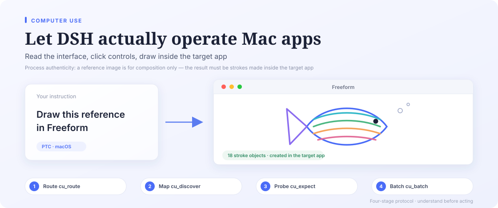

**Super Computer Use** does not move a finished result into an app. It drives the target application itself: reading its accessibility tree, clicking its controls, and drawing with its own brush on its own canvas.

- **Process authenticity**: a reference image is for composition and colour checking only. Deliverables must consist of strokes, timeline state and control actions created inside the target app. Rendering off-screen and uploading or pasting it does not count.
- **Four-stage protocol**: deterministic intent routing with `cu_route` → five-zone spatial mapping with `cu_discover` (OCR fallback for self-drawn UIs) → one minimal closed-loop probe → high-speed batch execution with `cu_batch` / `cu_cdp_paint`.
- **Watchable and interruptible**: each target has its own halo and native preview window; the chat card carries a live frame stream and a safe stop gate. Stopping one target leaves the others running.
- **Dispatched is not verified**: actions need an `expect` post-condition, or a `cu_expect` / fresh-frame check. Unverified effects report `effect_not_verified` instead of success.

System permissions, preferences and denied applications live under "Authorize Super Computer Use" on this page, or under Settings → Computer Use.
