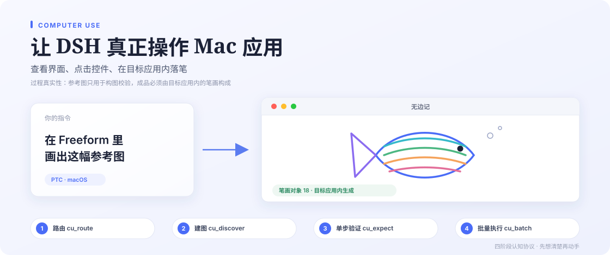

**Super Computer Use** 不是「把结果搬进应用」，而是让智能体真正驱动目标应用：读它的辅助功能树、点击它的控件、用它的画笔在画布里落笔。

- **过程真实性**：参考图只用于构图与配色校验。交付物必须由目标应用内的笔画、时间线状态和控件操作产生，离屏渲染后上传或粘贴不算完成。
- **四阶段认知协议**：`cu_route` 确定性意图路由 → `cu_discover` 五大分区建图（含自绘界面的 OCR 兜底）→ 单步最小闭环验证 → `cu_batch` / `cu_cdp_paint` 高速批量执行。
- **可观看、可中断**：每个目标有独立光环与原生预览浮窗，聊天内有实时画面与安全停止闸门；单目标停止不影响其他目标。
- **派发不等于成功**：动作需带 `expect` 后置条件，或由 `cu_expect` / 新画面核实，未验证会如实返回 `effect_not_verified`。

系统权限、偏好与「拒绝的应用」在插件详情页的「给 Super Computer Use 授权」中管理；也可在「设置 → 电脑控制」打开同一份配置。
